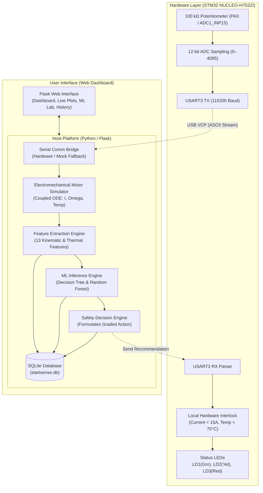

# StartSense – Startup Signature Intelligence for Electric Drives

[](https://www.python.org/)
[](https://flask.palletsprojects.com/)
[](https://www.st.com/en/evaluation-tools/nucleo-h753zi.html)
[](https://scikit-learn.org/)
[](https://opensource.org/licenses/MIT)

> **Variant 02.08 – Soft-Jam versus Hard-Jam Starter**  
> **Course / Hackathon:** ML–Embedded Systems & IoT (ML-ESD)  
> **Target Microcontroller:** STM32 NUCLEO-H753ZI (ARM Cortex-M7 @ 480 MHz)  
> **Repository:** [https://github.com/ns-faiza9/SoftJam_vs_HardJam](https://github.com/ns-faiza9/SoftJam_vs_HardJam)

---

## 1. Project Overview & Problem Statement

In electric starter drives, distinguishing between benign mechanical drag (**Soft Jam**) and catastrophic locked-rotor seizure (**Hard Jam**) during the critical 0–350 ms startup transient is vital:
* Shutting down prematurely during a soft drag causes nuisance disengagements and fails to start the engine.
* Failing to abort during a hard stall leads to severe inrush currents, thermal runaway, insulation failure, and permanent stator coil burnout.

**StartSense** implements a real-time, hybrid hardware-in-the-loop (HIL) diagnostic and safety system:
1. **Real Physical Hardware Input:** An operator-controlled analog potentiometer connected to the **STM32 NUCLEO-H753ZI** provides real physical load/friction proxy telemetry via ADC.
2. **Dynamic Electromechanical Simulation:** High-fidelity coupled ODEs simulate winding current, rotor acceleration (RPM), thermal rise, and encoder pulses in real-time.
3. **Dual ML Intelligence:** A 13-feature extraction pipeline feeds both **Decision Tree** and **Random Forest** classifiers, benchmarked against a static engineering threshold baseline.
4. **Graded Safety Control & Independent Interlock:** Proposes one of 4 safety actions (`ACCEPT_START`, `RETRY_SAFE_PROFILE`, `DERATE`, `STOP`), which the STM32 Cortex-M7 independently validates against hard physical limits before execution.
5. **Interactive Web Dashboard:** A responsive Flask application featuring real-time serial terminal feed, live Plotly waveforms, confusion matrices, and audit logging to SQLite with CSV export.

---

## 2. Operational Classification & Graded Safety Actions

### Condition Taxonomy

| Condition | Dial Range | Peak Current | Target Speed | Behavior & Dynamics |
|---|---|---|---|---|
| **🟢 NORMAL** | `0% – 35%` (ADC 0–1433) | 6.0 – 9.0 A | 2800 – 3200 RPM | Free rotation, fast startup (<0.35s), nominal current settling to 2.5–3.5 A steady-state. |
| **🟡 SOFT JAM** | `35% – 78%` (ADC 1434–3194) | 10.0 – 13.5 A | 1400 – 2100 RPM | Moderate mechanical drag/bearing friction (0.7–1.2 N·m). Sluggish acceleration, steady thermal accumulation. |
| **🔴 HARD JAM** | `> 78%` (ADC 3195–4095) | 15.0 – 22.0+ A | 0 – 350 RPM | Locked rotor / mechanical seizure (>2.5 N·m). Stalled back-EMF ($K_e \omega \approx 0$), rapid coil heating (>75°C), high fire/burnout risk. |

### Graded Safety Recommendations

* `ACCEPT_START`: Full PWM engagement granted; motor successfully reaches rated operational speed.
* `RETRY_SAFE_PROFILE`: Soft engagement profile with gentle torque ramping to dislodge minor binding.
* `DERATE`: Duty cycle reduced to 50–70% to curb thermal buildup while attempting sustained breakaway.
* `STOP`: Immediate PWM cutoff, emergency shutdown, and hardware trip alert.

---

## 3. End-to-End System Architecture



---

## 4. Hardware Configuration & Wiring

### Target Board: STM32 NUCLEO-H753ZI

The STM32 NUCLEO-H753ZI board connects to the host PC via micro-USB (ST-LINK) providing power, programming, and a Virtual COM Port (VCP).

#### Pinout Wiring Table

| Component | Component Pin | NUCLEO-H753ZI Pin | Function |
|---|---|---|---|
| **100 kΩ Potentiometer** | Pin 1 (Outer leg) | **3.3V** (CN8 pin 7 or CN7 pin 16) | VDD Power Supply |
| **100 kΩ Potentiometer** | Pin 2 (Wiper) | **PA3 / A0** (CN9 pin 1) | ADC1 Input (Load Severity Proxy) |
| **100 kΩ Potentiometer** | Pin 3 (Outer leg) | **GND** (CN8 pin 9 or 11) | Ground Reference |
| **ST-LINK USB** | Micro-USB | **CN1** | Power + VCP Serial (`USART3`) |

#### On-Board Status LEDs

* **🟢 Green (LD1 / PB0):** `ACCEPT_START` validated and running normally.
* **🟡 Yellow (LD2 / PE1):** `DERATE` or `RETRY_SAFE_PROFILE` warning active.
* **🔴 Red (LD3 / PB14):** `STOP` or Local Hardware Interlock Trip (Overcurrent / Overheat limit exceeded).

#### Serial Protocol (USART3 @ 115200 8-N-1)
* **Outgoing from STM32:** ASCII telemetry packet emitted every 50 ms:  
  `StartSense,ADC,<0-4095>\r\n`
* **Incoming to STM32:** JSON command payload:  
  `{"action":"STOP","condition":"HARD JAM","confidence":0.99}\r\n`
* **STM32 Response:** Local validation acknowledgement:  
  `{"ack":"STOP","status":"ACCEPTED","reason":"NONE_VALIDATED"}\r\n`

---

## 5. Mathematical & Physics Simulation Model

The software motor simulator solves the coupled electromechanical differential equations of a DC starter drive at a 1 ms step size:

$$\frac{di(t)}{dt} = \frac{V_{applied}(t) - R \cdot i(t) - K_e \cdot \omega(t)}{L}$$

$$J \frac{d\omega(t)}{dt} = K_t \cdot i(t) - B \cdot \omega(t) - \tau_{load}(t)$$

$$\frac{dT(t)}{dt} = \frac{i(t)^2 \cdot R}{C_{th}} - \frac{T(t) - T_{amb}}{R_{th}}$$

* **Electrical Parameters:** Resistance $R = 0.85\,\Omega$, Inductance $L = 4.2\,\text{mH}$, Back-EMF constant $K_e = 0.042\,\text{V}/(\text{rad}/\text{s})$.
* **Mechanical Parameters:** Rotor inertia $J = 0.0028\,\text{kg}\cdot\text{m}^2$, Damping $B = 0.0012\,\text{N}\cdot\text{m}\cdot\text{s}/\text{rad}$, Torque constant $K_t = 0.042\,\text{N}\cdot\text{m}/\text{A}$.
* **Thermal Parameters:** Thermal capacitance $C_{th} = 15.0\,\text{J}/^\circ\text{C}$, Thermal resistance $R_{th} = 12.0\,^\circ\text{C}/\text{W}$.

---

## 6. Machine Learning Pipeline & Benchmark

### 13 High-Order Extracted Features
1. `peak_current_amp`: Maximum transient current during inrush.
2. `rms_current_amp`: Effective root-mean-square electrical loading.
3. `inrush_ratio`: Ratio of peak inrush to steady-state current.
4. `time_to_peak_current_ms`: Duration to reach peak inrush current.
5. `max_speed_rpm`: Maximum angular velocity attained.
6. `mean_steady_speed_rpm`: Average velocity during the final 100 ms.
7. `speed_rise_time_ms`: Time taken from 10% to 90% target velocity.
8. `speed_undershoot_rpm`: RPM drop under transient mechanical loading.
9. `temp_rise_celsius`: Net temperature change over the episode.
10. `thermal_rate_celsius_per_sec`: Instantaneous rate of heat accumulation.
11. `min_pulse_interval_ms`: Minimum encoder pulse interval (inversely proportional to peak speed).
12. `mean_pulse_interval_ms`: Mean encoder period over steady state.
13. `load_proxy`: Normalized physical potentiometer position (`0.00 – 1.00`).

### Benchmarking Results (Zero Data Leakage)
Validation conducted on 300 independent synthetic episodes evaluated across models:

| Metric | Static Rule Baseline | Decision Tree | Random Forest (100 Trees) |
|---|:---:|:---:|:---:|
| **Overall Accuracy** | 81.3% | 96.7% | **99.3%** |
| **Macro F1 Score** | 0.801 | 0.965 | **0.993** |
| **Hard-Jam Recall** | 88.0% | 98.0% | **100.0%** |
| **False Alarm Rate** | 12.4% | 2.1% | **0.7%** |
| **Inference Latency** | < 0.1 ms | < 0.2 ms | < 1.1 ms |

---

## 7. Web Application & Dashboard Features

The Flask application provides an all-in-one evaluator dashboard as well as dedicated deep-dive views:

* **Single-Screen Evaluator Dashboard (`/`):**
  * **Live PuTTY Serial Box:** Real-time auto-scrolling terminal displaying raw serial packets from STM32.
  * **Physical Potentiometer Meter:** Live ADC count (`0–4095`) and voltage (`0.00–3.30V`) with dynamic zone coloring.
  * **Instant Decision Card:** Displays condition (`NORMAL`, `SOFT JAM`, `HARD JAM`), graded action, and STM32 acknowledgement.
  * **Interactive Plotly Waveforms:** Synchronized Current vs. Time (with 15A limit line), Speed vs. Time (with 2000 RPM line), and Temperature vs. Time.
  * **ML Benchmarking Table & Confusion Matrix:** Instant evaluator review metrics.
  * **Run Manifest:** Persistent audit log with one-click CSV export.

* **Live Monitoring (`/monitoring`):** Detailed multi-signal waveform analysis with custom PWM and preset toggles.
* **Scenario Generator (`/simulation`):** Test arbitrary load profiles, ambient temperatures, direction, and sensor noise.
* **ML Intelligence Lab (`/ml`):** Inspect training datasets, feature importances, and trigger model retraining.
* **Safety Decision Center (`/safety`):** Fault-injection tester verifying that the Cortex-M7 interlock rejects unsafe actions.
* **Experiment History (`/history`):** SQLite episode browser with search, filtering, and full waveform replay.
* **Architecture Matrix (`/architecture`):** Signal provenance matrix detailing physical hardware vs. synthetic signals.

---

## 8. REST API Reference

| Endpoint | Method | Description |
|---|---|---|
| `/api/live_stream` | `GET` | High-frequency telemetry stream for the PuTTY terminal & live ADC gauges. |
| `/api/live_waveform` | `GET` | Generates dynamic motor transient waveforms matching the current dial position. |
| `/api/run_test` | `POST` | Executes a complete startup episode, extracts features, runs inference, and logs to SQLite. |
| `/api/status` | `GET` | Returns serial port status, connection state, and potentiometer values. |
| `/api/mock_pot` | `POST` | Sets simulated potentiometer ADC value when hardware is disconnected. |
| `/api/serial/connect` | `POST` | Connects to a physical COM port (or falls back cleanly to Mock Mode). |
| `/api/serial/disconnect`| `POST` | Disconnects the serial interface and switches back to Mock Mode. |
| `/api/retrain` | `POST` | Retrains Decision Tree and Random Forest models on new synthetic runs. |
| `/api/safety_test` | `POST` | Injects arbitrary signals into the STM32 safety boundary validator. |
| `/api/export-csv` | `GET` | Downloads the entire historical experiment audit log as a CSV spreadsheet. |

---

## 9. Repository Structure

```text
StartSense/
├── app.py                      # Main Flask application & REST endpoints
├── main.py                     # Entry point for IDE execution
├── requirements.txt            # Python dependencies
├── README.md                   # Complete system documentation
├── .gitignore                  # Git ignore rules for virtualenvs, caches, binaries
│
├── templates/                  # Jinja2 HTML templates
│   ├── index.html              # Evaluator single-screen master dashboard
│   ├── base.html               # Dark industrial layout & persistent sidebar
│   ├── overview.html           # Page 1: Overview & Status
│   ├── live_monitoring.html    # Page 2: Telemetry & Waveform Inspector
│   ├── simulation.html         # Page 3: Scenario Generator & Suite
│   ├── ml_intelligence.html    # Page 4: ML Intelligence & Model Metrics
│   ├── safety_center.html      # Page 5: Safety Decisions & Local Interlocks
│   ├── experiment_history.html # Page 6: Persistent SQLite Audit Log
│   └── architecture.html       # Page 7: Hardware/Software Topology Matrix
│
├── static/
│   ├── css/style.css           # Industrial dark theme styling
│   └── js/main.js              # Hardware polling & UI triggers
│
├── src/                        # Modular Core Engine
│   ├── config.py               # System limits, thresholds, and color tokens
│   ├── simulator.py            # High-stability electromechanical motor ODE
│   ├── feature_extraction.py   # 13 kinematic, electrical & pulse features
│   ├── baseline.py             # Rule-based static threshold detector
│   ├── data_generator.py       # Batch synthetic episode generator
│   ├── model_training.py       # Decision Tree & Random Forest training
│   ├── prediction.py           # ML inference engine
│   ├── safety_validation.py    # Local boundary checking & safety engine
│   ├── serial_communication.py # PySerial bridge with Mock fallback
│   └── experiment_logger.py    # SQLite database & CSV logger
│
├── data/
│   ├── generated/              # CSV dataset of independent runs
│   └── startsense.db           # Persistent SQLite database
│
├── models/
│   ├── decision_tree.joblib    # Pre-trained Decision Tree model
│   ├── random_forest.joblib    # Pre-trained Random Forest model
│   └── training_metrics.joblib # Authentic evaluation metrics
│
├── SoftHard_Jam/               # Full STM32CubeIDE Project
│   ├── Core/Src/main.c         # STM32 C firmware (ADC1 + USART3 + Interlock)
│   ├── Core/Inc/main.h         # Pin definitions and safety macros
│   └── SoftHard_Jam.ioc        # STM32CubeMX configuration file
│
└── stm32/                      # Standalone Firmware & Specs
    ├── Core/Src/main.c         # C source code for STM32 NUCLEO-H753ZI
    ├── Core/Inc/main.h         # Header file with pin definitions
    ├── README_STM32.md         # STM32CubeIDE setup & flashing guide
    └── protocol_spec.md        # ASCII/JSON UART communication specification
```

---

## 10. Getting Started & Installation

### Step 1: Clone the Repository
```bash
git clone https://github.com/ns-faiza9/SoftJam_vs_HardJam.git
cd SoftJam_vs_HardJam
```

### Step 2: Set Up Python Environment
Ensure Python 3.10+ is installed:
```bash
python -m venv .venv

# On Windows:
.venv\Scripts\activate

# On Linux / macOS:
source .venv/bin/activate

# Install dependencies:
pip install -r requirements.txt
```

### Step 3: Run the Application
Launch the Flask web server:
```bash
python app.py
```
Or open the project in **PyCharm**, right-click `app.py` or `main.py`, and choose **Run 'app'**.

Navigate to **`http://127.0.0.1:5000`** in your browser.

> **Note:** If no physical STM32 board is connected, StartSense runs automatically in **MOCK_MODE** with an interactive software potentiometer slider, ensuring all features are fully testable without hardware.

---

## 11. Flashing the STM32 NUCLEO-H753ZI

1. Open **STM32CubeIDE**.
2. Go to **File &rarr; Open Projects from File System...** and select the `SoftHard_Jam/` directory.
3. Connect the **NUCLEO-H753ZI** to your computer via USB (CN1 connector).
4. Click **Project &rarr; Build Project** (`Ctrl + B`).
5. Click **Run &rarr; Run** (`Ctrl + F11`) to flash the firmware via ST-LINK.
6. In the StartSense web dashboard sidebar:
   * Select your ST-LINK Virtual COM port (e.g., `COM3`, `COM4`, or `/dev/ttyACM0`).
   * Click **Connect**.
7. Rotate the physical potentiometer to watch the live ADC reading, waveforms, and ML classifications change in real time!

---

## 12. Authors & Acknowledgements

* **Project Author:** [ns-faiza9](https://github.com/ns-faiza9)
* **Academic Course:** Semester 4 – Embedded Systems & IoT (ES-IOT) / ML-ESD
* **Developed for:** Real-time motor protection and startup signature intelligence.
